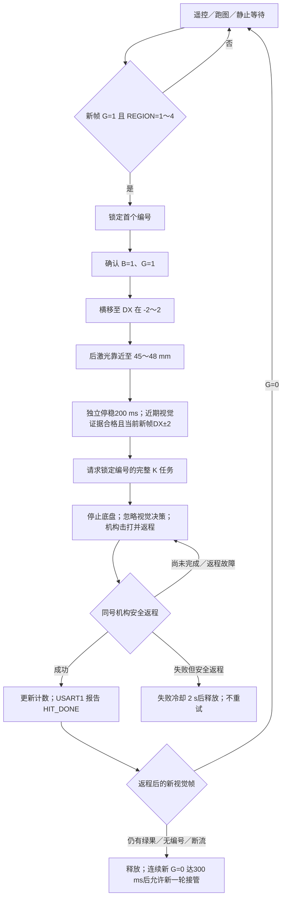

# 视觉控制逻辑

本文按 `merge/c30d-rebuild-vision-20261120` 分支整理，状态机基线为 `f8e685f`，并同步其后的前后行驶航向参数调整；更新日期为 2026-11-20。描述当前固件实现，供调试及交接给其他 Codex 使用。旧版对中、击打和流程文档中的历史参数，以本文及实际代码为准。

## 1. 总体流程与执行入口

当前流程是：**遥控或跑图接近 → 锁定绿果编号 → 横向对杆 → 后激光靠近 → 停稳确认 → 完整 K 任务 → 安全返程 → 重新识别或释放控制权**。也允许不连接手柄，直接将车放在目标附近，底盘初始化完成后自动进入。

视觉接收中断只解析数据，不启动电机或机构。视觉对齐和击打派发统一运行在原有 100 Hz 底盘循环，无新增视觉控制任务。

| 配置 | 当前值 | 含义 |
| --- | --- | --- |
| `VISION_ALIGN_ENABLE` | 1 | 启用视觉对齐 |
| `VISION_PICK_ENABLE` | 1 | 启用对齐后的完整击打流程 |
| `VISION_STRIKE_ENABLE` | 0 | 关闭 DATA 任务中的独立击打派发，避免重复请求 |

`VISION_STRIKE_ENABLE=0` **不代表关闭当前视觉击打**；完整流程由 `VisionAlign_Drive()` 调用 `StepperTask_RequestMango()`。



图中省略了各阶段的就绪保护和超时。具体释放条件见第 7 节。

## 2. 视觉输入与协议

MCU 使用 **USART3，115200、8N1、无流控**，PD8/TX、PD9/RX。当前解析固定六字节二进制帧，不是 ASCII 文本：

```text
0x63  B  DX  G  REGION  0x66
```

| 字段 | 范围 | 含义与约束 |
| --- | --- | --- |
| B | 0 / 1 | 是否识别到树干 |
| DX | int8，-128～127 | 图像横向偏差原始值；没有毫米换算。B=0 时必须发送 0 |
| G | 0 / 1 | 是否有绿色果子标记 |
| REGION | 0～4 | 0 为无编号；B=1 且 G=1 时允许 0～4，其余组合必须为 0 |

例如 `63 01 EC 01 03 66` 表示 B=1、DX=-20、G=1、REGION=3。`B=0、G=1、REGION=0` 是合法帧，但不能提供真实 DX 或启动新的锁号。

解析成功才增加 `camera_frames`。坏数据使用六字节滑动窗口重新同步；UART 错误增加错误计数并丢弃未完成帧。`Camera_GetData()` 在短临界区内复制一致快照。

控制逻辑以帧计数变化判断“新快照”，重复读取缓存不会增加确认次数。300 ms 内没有新的有效快照，不能继续按正常视觉数据控制。中断持续收数据不等于正在使用这些数据作决策。

## 3. 自动接管与锁号

### 就绪条件

底盘须为麦轮模式，初始化等待完成、EN 有效、未停止、电压至少 10 V、无自检阻断，且姿态有效、更新时间差不超过 100 ms。步进、舵机、串口舵机控制或路线机构预留忙碌时，不允许开始新的视觉动作。

APP、航模遥控、CAN/串口运动控制标志或回充模式存在时，当前视觉入口不获准执行。USB/PS2 手柄和新跑图入口允许经过视觉入口。

### 锁定编号

1. 就绪、未处于检测超时封锁且尚未锁号时，**首次新的 G=1、REGION=1～4 快照即锁号**，`lock_count` 加一。
2. 已锁号后，当前原始 REGION 变成 0 或其他编号，不立即换号；本轮仍向已锁定编号提交任务。
3. 只有新的 G=1 且原始 REGION 等于锁号，才更新本轮编号的最后有效时间。缓存、其他编号及辅助 DX 不能刷新该时间。
4. 对齐／击打准备期间，锁定编号连续 2 s 未再次真实出现，或视觉断流达到 300 ms，进入释放流程。超时周期恰有同号新帧时，可按本次真实观测继续。
5. 成功返程清除本轮锁号，后续重新识别；失败但安全返程的有限重试可保留本轮编号。

尚未锁号时，`G=1、REGION=0` **不会单独让车停车或开始对齐**。这与早期“见绿果就停车检测 2 s”的版本不同。

代码仍维护 `VisionStrike_Update()` 的候选证据，但当前完整流程**不以三票多数作为击打提交条件**，也不要求提交瞬间的原始 REGION 与锁号相同。原始 CH3 不被内部锁号替换，实际锁号看 CH41。

### 接管时机

有锁号后，真实 B=1、G=1 的连续新快照用于确认目标。首次确认需要 3 个新快照；遥控拨杆时确认前继续遥控，确认后立即接管，**不要求摇杆回中**。无手柄时第一帧进入 ACQUIRE 等待确认。

进入 ACQUIRE、TRACK 或丢失后的自动恢复阶段，摇杆不覆盖视觉动作。仅有 B=1 或 G=1 的新鲜数据时，入口保留既有 330 mm/s 视觉减速；自动对齐使用自己的速度参数。遥控设置上限为 480 mm/s。

## 4. 对齐与后距靠近

坐标为车体 X 向前、Y 向左。当前 `DX_TO_X=0`、`DX_TO_Y=1`，即 DX>0 输出正 Y，DX<0 输出负 Y；这是代码输出方向，应结合当前装车朝向理解，不能直接当作地图左右。

### 先横向，再纵向

1. TRACK 阶段先只横移，**-2≤DX≤2** 视为横向中心范围。
2. 连续 3 个新快照确认横向到位后，进入后激光靠近。
3. 后距靠近时只调 X；|DX|≥5 时退回横向对齐。
4. 集成入口另外监测持续同侧的 DX 偏离：DX=±3／±4 连续 3 个新快照也可退回横移，防止停在无法完成的间隙。正负交替或缓存不能累积。
5. 最终 DONE 需要真实 B/G 有效、DX 在 ±2 内、后激光到位，并经新快照确认。后距一开始已经到位时，不另强加一轮相同的距离等待。

### 参数与实际限速

| 项目 | 当前实现 |
| --- | --- |
| 横移基础速度 | `0.010 × |DX|` m/s，先限制在 0.12～0.24 m/s |
| 中心附近横移 | 2＜|DX|＜8 时再乘 `|DX|/8`，并限制不超过 0.06 m/s；DX=3 约 0.045 m/s、DX=4 约 0.060 m/s |
| 小偏差反向 | |DX|＜8 且方向改变时，需要连续 3 个新快照，确认期间停止横移 |
| 后距目标 | 45 mm；结合安全下限，实际对齐到位范围为 **45～48 mm** |
| 后距速度 | `0.004 × |后距-45|` m/s，基础范围 0.04～0.12 m/s |
| 后距方向 | 过远则 X<0 后退；过近则 X>0 前进 |
| 实际纵向指令 | 还会经过方向激光防撞限速，因此可低于上述基础最低速度 |

后距使用最近 3 个不同 CAN 快照的中值；样本不足时使用当前值。原始后距≤45 mm 时直接覆盖中值，不能用滤波掩盖近障碍。CAN 帧时效为 300 ms，各方向有效读数范围为 1～6000 mm，无效值发布为 0。

视觉运动的前后防撞保留 45 mm 边界：前进仅在前距>45 mm 且新鲜时允许，后退仅在后距>45 mm 且新鲜时允许。前进速度上限为 `(前距-45)×0.002` m/s；自动后退为 `(后距-45)×0.004` m/s。这是运动限制，**前距并不是额外的击打资格条件**。

### 短时辅助 DX 与丢失恢复

仅在自动横移 TRACK、尚未进入后距靠近、G 仍有效且真实 B 暂时丢失时，允许按上一真实 DX 产生的横移指令续移：放大 1.5 倍，最高 0.24 m/s，最长到最后真实 DX 后 300 ms。

它记住的是上一横移指令，不是测得或推算出的真实距离。新真实 DX 立即更新；回中、G=0、激光无效、超时、取消及退出流程会停止续移。后距靠近不允许靠记忆继续纵向运动；击打执行期间及释放控制后不执行辅助 DX。

续移不满足条件或数据过期后进入 LOST，平移停止并保留全局航向保持。恢复需要连续 6 个真实 B=1、G=1 新快照；丢失恢复不会重置本次 10 s 对齐期限。

## 5. 停稳与击打提交

DONE 后进入 PICK_WAIT。四轮连续静止 **200 ms** 的计时独立于视觉资格；击打提交时还必须满足：

- 底盘就绪，真实 B=1、G=1，有锁定的 1～4 号，视觉未超过 300 ms。
- 当前新的真实B/G帧DX在±2内，最近5个真实B/G观测中至少3个DX在±2内，证据各自不足300 ms。丢杆或丢果清除视觉证据，重复缓存不加票、不启动击打。
- CAN 新鲜；原始后距≥45 mm 且<80 mm，滤波后距在 42～48 mm。前面的 DONE 条件已把正常到位范围收紧为 45～48 mm。
- 四轮编码器反馈绝对值分别≤0.005 m/s。
- 上次完成报告已被发送任务清除，当前尝试次数仍在额度内。

视觉或后距暂时不合格仍回PICK_WAIT并禁止击打，但不清除已经完成的四轮停稳计时。任一轮速超过0.005 m/s、离开DONE重启纠偏、失去底盘就绪或退出该轮作业时，清除停稳计时；再次停车须重新连续静止200 ms。持续位置偏离仍会重新进入相应对齐阶段。PICK_HOLD只表示当前资格合格，不能仅按该阶段持续时间推算静止时长。没有固定的12 s停车等待上限；绿果、编号和通信超时继续按各自条件释放。

**当前没有额外的 IMU 航向误差／角速度硬门限，也没有单独的 IMU 对准状态。** 全局 PID 同周期控制航向，但击打资格只用上述条件；因此代码不保证击打时绝对航向误差为零。航向纠偏造成轮速未停稳时，仍会推迟提交。

`StepperTask_RequestMango(锁号)` 接受后才增加尝试次数并进入 PICK_WORK。忙碌或拒绝不算成功提交。对齐器保留的 DONE 1 s 参数，不应理解为当前击打前还要固定多等 1 s；完整流程以本节的停稳计时为准。

## 6. 机构作业、返程与重复次数

| REGION／任务 | 机构激光 | 步进 | 舵机 | 机构击打距离阈值 |
| --- | --- | --- | --- | --- |
| 1／K1 | 1 | 左 | 1 | <108 mm |
| 2／K2 | 2 | 左 | 2 | <60 mm |
| 3／K3 | 3 | 右 | 3 | <45 mm |
| 4／K4 | 4 | 右 | 4 | <35 mm |

表中为机构自己的选通激光，**不是底盘 S21C 后激光 45 mm 停车距离**。

K1／K2先确认2号舵机到0°，K3／K4先确认3号到0°，再选择本号激光、等待有效测距、步进靠近、本号舵机击打并回零、按实际输出的前进脉冲数返程、确认激光关闭，最后将配对的2／3号舵机恢复90°。首次测距最多等 5 s；靠近中测距失效先停步进并等待最多 2 s 恢复，不再单次无效立即返程。前进脉冲上限为 26000；运动超时、脉冲上限及返程计数检查继续由机构驱动执行。返程确认基于指令脉冲数，不能检测机械失步或打滑，不能等同于物理原点传感器确认。

步进前进和返程均为200 Hz起步、约11250脉冲/秒（ARR=88，理论11236）巡航，保留200脉冲加减速和单步周期变化限制。26000脉冲完整行程的理想定时约3.30 s，其中起步加速约0.51 s；定时器中断开销与机械负载的实际影响需实机验证。

PICK_WORK 期间三轴停止，暂停底盘 IMU 姿态调整；视觉中断继续接收，但消费并忽略这些帧，不换号、不重新对齐，也不因 G 消失而提前放车。只有机构不忙且快照为**同号 STEPPER_RETURNED**才认为已安全返程；STEPPER_FAULT 不会当作完成。

成功返程还要求结果 `MANGO_OK`：更新最近成功编号和成功次数，设置完成报告，进入 PICK_REPORT。DATA 任务在 **USART1** 发送：

```text
CMD HIT_DONE n\r\n
```

它不是发回 USART3 的视觉确认帧，也不代表独立检测到果子已经掉落。返程后先等待一份新的视觉快照，不能用作业前缓存决策；最多等 300 ms，无新帧则释放。

- 新 G=0：退出自动；仍有绿果也因本轮额度已耗尽而释放，不重新锁号或补打。成功后没有固定 2 s 冷却。
- 新 G=1、REGION=0：释放并封锁当前绿果事件，等待后续新 G=0。
- 失败但安全返程：PICK_COOLDOWN 冷却 2 s 后释放，不自动重试；冷却分支允许原输入执行，但路线仍会因流程占用而暂停。

`VISION_PICK_MAX_REPEATS=0` 表示同一轮绿果事件只接受一个完整 K 请求，成功、失败和换号均不会再次作业。连续300 ms收到新的G=0帧才重新允许下一轮接管；冷却期间短暂G=0不清除本轮已用额度。舵机绝对位置指令的限次重发继续保留，它不新增K任务。

此外，每次上电最多接受4个视觉自动K任务（`VISION_PICK_BOOT_MAX_ATTEMPTS=4`）。机构接受请求时计数，失败但已接受的任务也计一次；第4次仍须完成安全返程，机构故障锁定继续保留。达到上限后不再锁果或自动对齐，交回原遥控／跑图输入。无果、换号、退出重进跑图、EN切换均不清除此计数，只有主控复位／重新上电恢复。手动K命令和下述P10空转不占此额度；CH40仅统计成功次数，不等于已用额度。

### P10到点空转

每轮跑图在P10验收到点后，先预约机构并暂停P11的移动；确认导航停稳后，4号舵机执行一次0°→180°→0°，复用现有位置反馈和超时。此动作不选机构激光、不启动步进、不增加视觉击打次数，也不发送HIT_DONE。完成后释放预约，重新取得导航参考并继续P11。本轮不重复触发，重开一轮跑图后可再次执行。

空转失败时保留停车及预约，等待显式停止跑图后检查；停止或手柄终止本轮跑图时取消未完成的空转并清理预约。USART1分别输出`P10 servo 4 dry cycle start/done/ERROR`。VOFA可结合CH49=10、CH48=11、CH46=5／6及CH47=10识别该暂停；CH38不进入视觉PICK_WORK，CH60不代表该舵机空转状态。

## 7. 控制权释放、超时与跑图衔接

| 情况 | 当前行为 |
| --- | --- |
| 机构接受前收到新的 G=0 | 清锁号、DX 记忆及自动状态，停止一次后释放；后续可重新识别 |
| 对齐持续达 10 s，包括 LOST 恢复时间 | 退出自动并设置检测超时封锁 |
| 锁号连续 2 s 未真实刷新，或有效帧断流达 300 ms | 适用阶段退出，禁止继续用辅助 DX 顶替识别 |
| DONE 后没有有效锁定目标／准备等待达 12 s | 释放并封锁当前事件 |
| 安全返程后等待新帧超过 300 ms | 释放，不无限停等 |
| 事件次数耗尽仍有绿果／返程后无编号 | 释放并封锁当前事件 |
| 封锁后绿果一直为 1 | 继续原输入，不立即重新抢占；新的 G=0 才解封，之后的新目标才能接管 |
| 机构作业未安全返程或返程故障 | 保持作业停车，不按普通视觉超时释放 |
| 失能、低压、姿态无效、模式不允许等 | 遵循底盘保护；释放自动意图不等于允许电机输出 |

“释放”指不再由视觉提供平移指令；释放当周期通常先显式停车，下一底盘周期才恢复原输入。全局航向保持在就绪且非机构作业期间仍可调整姿态，所以释放后无平移输入也可能有小幅旋转纠偏。

当前全局 IMU 为 REBUILD 采样、连续 200 次静止校零及浮点航向积分，加原分支基础 PID：P=2.4、I=0.4、D=0.75，上限±0.8 rad/s，基础角度容差约 0.57°。视觉平移、停车准备及丢失等待共用该控制器；有限积分最多贡献±0.2 rad/s。

前后行驶增加随指令速度平滑变化的航向参数：经过激光防撞后的 |X 指令| 达到 0.12 m/s 时，P=3.6、D=1.0，角度容差收紧至 0.2°、角速度容差为 0.01 rad/s；低于该速度在基础与行驶参数之间线性过渡。前进、倒退相同，积分、起转助力及输出上限保留。遥控、跑图和视觉后距靠近共用此入口，不因航向误差单独禁止前后运动；停车和纯横移仍使用基础参数。这是抑制车辆偏航，不改变 IMU 采样或零偏计算。

跑图调用同一视觉入口。视觉／机构占用时，导航暂停并保留当前路段和目标；释放后继续原目标。拨动手柄会终止本轮跑图，需明确重新起跑；若此时视觉已持有控制权，取消路线不代表摇杆可以覆盖对齐或机构安全锁。跑图正常行驶的激光规则按 REBUILD，视觉自动运动仍保留自己的 45 mm 防撞限制。

## 8. 状态与 VOFA 排查

| CH5 对齐状态 | 编号 | 含义 |
| --- | --- | --- |
| IDLE / ACQUIRE / TRACK | 0 / 1 / 2 | 初始／确认／执行横移或后距靠近 |
| DONE / LOST / TIMEOUT / WAIT | 3 / 4 / 5 / 6 | 到位／目标丢失／期限耗尽／等新目标 |

| CH38 击打阶段 | 编号 | 含义 |
| --- | --- | --- |
| PICK_IDLE / PICK_WAIT / PICK_HOLD | 0 / 1 / 2 | 未准备作业／等资格／连续停稳计时 |
| PICK_REPORT / PICK_COOLDOWN / PICK_WORK | 3 / 4 / 5 | 成功返程后判断／失败冷却／机构作业中 |

击打时对齐状态会被清到 IDLE，因此 **CH5=0 不能单独判断“没有执行”**，须结合 CH38。超时通常很快转换为 WAIT，400 ms 遥测不一定捕捉到 TIMEOUT 瞬间。

| 观察内容 | 通道 |
| --- | --- |
| 原始 B、DX、G、REGION、有效帧计数 | CH0～4 |
| CAN 新鲜、后距、前距 | CH6、7、8 |
| 横移、旋转指令 | CH9、10 |
| 目标航向、实际航向、误差、角速、积分 | CH11～15 |
| 航向锁、姿态新鲜、视觉阻断位 | CH16、17、18 |
| 四轮目标／反馈／PWM | CH19～22／CH23～26／CH27～30 |
| 串口接收字节／坏帧／UART 错误 | CH35～37 |
| 击打阶段／最近成功编号／成功次数 | CH38～40 |
| 当前锁号／累计锁号次数 | CH41、42 |
| 导航状态／原因／目标点 | CH46～48 |
| 视觉或击打流程占用 | CH55 |

CH18 为按位组合，可同时有多项：2 自检、4 未使能、8 停止、16 电压不足、32 初始化未结束、64 姿态无效、128 姿态过期、512 步进忙、1024 舵机忙、2048 串口舵机忙、4096 路线机构预留、8192 模式不允许。PICK_WORK 时自己的机构忙属于预期，不能据此判定视觉接管失败。

当前 VOFA 为 58 通道、计划 400 ms 一帧，适合观察阶段和趋势，不能精确证明每个 10 ms 周期或连续 300 ms 停稳过程。具体机构失败结果没有独立 VOFA 通道，应读取 USART1 的 `mango` 结果文本，结合 `result`、`out`、`back` 判断。完整通道表见 [VOFA 跑图、视觉与底盘诊断](VOFA跑图诊断.md)。

## 9. 代码定位与验证边界

下列源码路径均相对于仓库目录 `R550_C30D_2.0_Mini_STM32_GMR_Encoder_2025.12.26/`：

| 文件／入口 | 职责 |
| --- | --- |
| `HARDWARE/camera_protocol.h`：`Camera_Push` | 六字节解析与计数 |
| `HARDWARE/usartx.c`：`USART3_IRQHandler`、`Camera_GetData`、`data_task` | 视觉接收、快照、USART1 完成报告 |
| `BALANCE/balance.c`：`VisionAlign_Drive` | 实际锁号、超时、对齐及击打状态机集成入口 |
| `USER/vision_align.h`：`VisionAlign_Update` | 对齐、后距、辅助 DX、恢复及参数 |
| `USER/vision_strike.h` | PICK 枚举、时限、额度、距离滤波及候选证据 |
| `BALANCE/stepper_task.c/.h` | 完整 K 任务、结果及安全返程 |
| `BALANCE/heading_control.c/.h` | 共用 PID 航向控制 |
| `USER/route_io.c`、`USER/my_chassis_task.c` | 激光快照、导航输入与暂停／继续 |

交接时应同时阅读 `balance.c` 的集成入口，不能仅按 `vision_align.h` 或已关闭的独立派发器推断整车行为。现有回归包括锁号、DX 丢失、后距 45 mm、停稳、检测超时、有限重试、作业期间忽略视觉及导航暂停恢复；入口为 `tests/chassis/run_vision_align_integration.py`，传入相应 `test_vision*.c`。

本文按源码核对，仅新增文档，不改变固件。软件回归不能证明真实负载、轮胎打滑、传感器安装及击打机构在实车上均正常。
