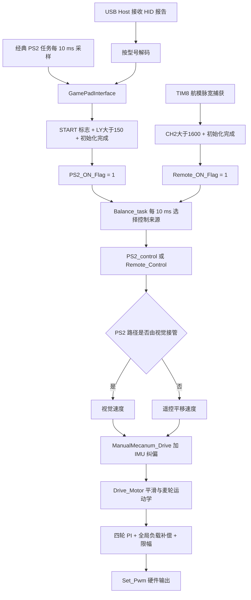

# 遥控代码交接给 Codex

核对日期：2026-11-18。本文按当前工作区源码整理，供接手遥控功能的 Codex 阅读。本次整理只增加文档和源码快照，不修改固件行为。

后续已按用户要求修改固件：PS2/USB 与航模的麦轮遥控默认速度、单轴限速均为 200 mm/s，旧 Flash 速度和加速键也会受限；IMU 共用控制器为 Kp=1.20、Kd=0.55、限幅 ±0.50 rad/s；横移起步额外助力 A/D=2000、B/C=1000 PWM。PS2/USB 遥控时，连续 3 次新 B=1 数据后立即自动接管，无需松杆，前两次确认期间继续遥控。完成后中心附近不会反复抢占，只有符合偏差门槛的新确认才再次自动接管。以下旧公式中的 RC_Velocity 在计算前均经 0～200 mm/s 限幅。

对齐完成后先强制三轴零速停车 1 秒，再释放给遥控。实现为 `VISION_ALIGN_DONE_HOLD_MS=1000` 和完成时记录 `stopped_ms`，使用时间差判断，不阻塞底盘任务。DONE 的这一秒仍属自动锁定（VOFA 9=1），期间摇杆无效，视觉快照不计入下一轮确认；1000 ms 到期后释放（VOFA 9=0）。

## 1. 项目位置与阅读范围

```text
Git 根目录：C:\Users\27188\Desktop\C30D-develop\C30D-develop
EIDE 工程： C:\Users\27188\Desktop\C30D-develop\C30D-develop-EIDE
固件目录：  Git 根目录\R550_C30D_2.0_Mini_STM32_GMR_Encoder_2025.12.26
```

下文 `FW/` 均指上述固件目录。当前工程是 STM32F407、FreeRTOS、四轮麦克纳姆底盘，主要关注 `Mec_Car` / `Mec_Car_V550` 分支。其他车型保留旧分支，不要把它们的按键和转向行为当作当前麦轮行为。

工作区有大量尚未提交的底盘、视觉、遥控与机构修改。先查看 `git status --short`、相关文件 diff 和 EIDE 的 `build/FreeRTOS/compile_commands.json`，保留已有修改；仅查看 HEAD 会遗漏当前实现。旧 `BALANCE/control.c` 不在当前编译列表中，遥控入口在 `BALANCE/balance.c`。

## 2. 已确定的要求

- 遥控输入、底盘、IMU 默认同为 FreeRTOS 优先级 12，通过阻塞等待、周期延时和同级时间片调度。优先级集中配置，可覆盖，不增加强制严格排序或长期锁调度。
- 麦轮用左摇杆前后控制纵向，右摇杆左右控制横移，允许组合斜移。摇杆不提供主动自转，旋转由 IMU 航向保持抑制。
- 当前车头朝地图后方，车左对应地图右方。PS2/USB 平移映射已经按该摆放反转，公式见第 5 节。航模通道保留自己的现行映射。
- 视觉 `ACQUIRE` / `TRACK` 阶段纯自动，摇杆不能中断对中。这是用户要求，不是遥控失效故障。
- 无遥控器也可以直接摆车等待视觉自动对中。自动激光、步进和视觉击打当前不启用，不因整理遥控而打开。
- 负载补偿位于全局轮输出层，遥控沿用它。用户所说重载“前轮”是地图前方 A/D，不能改回 B/C。

## 3. 建议阅读的文件

| 相对 FW 的路径 | 重点 |
| --- | --- |
| `BALANCE/balance.c` | `Balance_task`、`PS2_control`、`Remote_Control`、`ManualMecanum_Drive`、`VisionAlign_Drive`、三种手柄按键回调、`Smooth_control` |
| `HARDWARE/bsp_gamepad.c/.h` | 共用 `GamePadInterface`、按键事件检测、USB 插拔处理 |
| `HARDWARE/USB/USB_HOST/App/usb_host.c` | USB 初始化、HID 回调、手柄模式接管条件 |
| `HARDWARE/USB/USB_HOST/App/usbh_hid_GamePad.c/.h` | USB 手柄识别和解码分发 |
| `HARDWARE/USB/USB_HOST/App/WiredPS2_gamepad.c/.h` | USB PS2 报告解析与按键编号 |
| `HARDWARE/USB/USB_HOST/App/xbox360_gamepad.c/.h` | Xbox/兼容接收器解析与按键编号 |
| `HARDWARE/pstwo.c/.h` | V1.0 经典 PS2 采样、模式接管及异常输入处理 |
| `HARDWARE/timer.c/.h` | TIM8 航模脉宽捕获、航模模式接管 |
| `BALANCE/heading_control.c/.h` | IMU 航向控制器、角速度阻尼和参数 |
| `USER/chassis_odometry.c/.h` | 编码器位移、IMU 航向与姿态有效性 |
| `USER/vision_align.h` | 手柄与自动对中的状态切换 |
| `USER/route_io.c/.h` | 路线对底盘的所有权和速度命令入口 |
| `BALANCE/wheel_output.h` | 四轮独立前馈、欠速助力、PI 输出余量 |
| `USER/main.c`、`USER/task_priority.h` | 任务创建与优先级默认分配 |
| `HARDWARE/USB/USB_HOST/Target/usbh_conf.h` | USB 原生 FreeRTOS 优先级 |
| `HARDWARE/USB/STM32_USB_Host_Library/Core/Src/usbh_core.c` | 枚举等待、失败重试；已移除旧整机复位分支 |

## 4. 输入到电机的流程



航模麦轮分支直接调用 `ManualMecanum_Drive`，不经过 `VisionAlign_Drive`。APP、CAN、串口有各自入口；本文不将它们重新映射为 PS2。

### 手柄接管的实际条件

USB 的 `USBH_HID_EventCallback` 先解码，再检查：

```c
GamePadInterface->StartFlag == 1 && PS2_ON_Flag == 0 &&
SysVal.Time_count >= CONTROL_DELAY && GamePadInterface->LY > 150
```

经典 PS2 的 `pstwo_task` 使用同一条件。`CONTROL_DELAY=1000`，时间计数由 100 Hz 底盘任务递增，约为上电后 10 秒。单击 START/Menu 只设置 `StartFlag`，还需报告中的 LY 大于 150 才设置 `PS2_ON_Flag`。不要把“接收器识别完成”“无线灯常亮”“已接管底盘”当作同一个状态，也不要凭映射反转后的直觉描述这个启动杆方向，应以原始 LY 为准。

接管时清除 `Remote_ON_Flag`、`APP_ON_Flag`、`CAN_ON_Flag`、`Usart1_ON_Flag`、`Usart5_ON_Flag`。这不清除路线所有权，也不会允许摇杆中断已经进行的视觉对中。

V1.0 使用经典 PS2 任务；V1.1 的该任务自行删除，由 USB Host 处理输入。航模在 TIM8 中断检查 `Remoter_Ch2 > 1600` 和初始化完成后接管；`Remote_Control` 还有静态 `thrice=100` 的首次等待，约 1 秒，该变量不是每次切回模式都自动重装。

## 5. 当前映射与单位

### PS2 / USB 手柄的麦轮分支

```c
forward = (float)GamePadInterface->LY - 127.0f;
left    = 127.0f - (float)GamePadInterface->RX;
if (fabsf(forward) < 20.0f) forward = 0.0f;
if (fabsf(left)    < 20.0f) left    = 0.0f;

vx = forward * RC_Velocity / (127.0f * 1000.0f);
vy = left    * RC_Velocity / (127.0f * 1000.0f);
VisionAlign_Drive(vx, vy);
```

| 输入 | 结果 |
| --- | --- |
| LY > 127 且超出死区 | 车体 +X |
| LY < 127 且超出死区 | 车体 −X |
| RX < 127 且超出死区 | 车体 +Y |
| RX > 127 且超出死区 | 车体 −Y |
| 左杆左右 LX、右杆前后 RY | 当前麦轮分支不用 |
| 两个有效轴同时偏移 | 组合平移；未额外做圆形摇杆归一化 |

车体 +X 为车体前方，+Y 为车体左方。`RC_Velocity` 单位 mm/s，`vx/vy` 单位 m/s，IMU 输出 `wz` 单位 rad/s。中心按 127 计算，原始范围 0～255，所以正端 128/127 略大于 1；这是当前源码行为，不要在整理时顺手改变。

### 航模麦轮分支

```c
forward = clamp(Remoter_Ch2, 1000, 2000) - 1500;
right   = clamp(Remoter_Ch1, 1000, 2000) - 1500;
// -100 < 值 < 100 时置零
vx =  forward * RC_Velocity / 500000.0f;
vy = -right   * RC_Velocity / 500000.0f;
ManualMecanum_Drive(vx, vy);
```

CH2 控纵向、CH1 控横移，CH3/CH4 不参与当前麦轮运动，不作摇杆自转。不要照搬函数后面其他车型使用的 CH4 横移、CH3 油门和 CH1 自转逻辑。

## 6. 当前手柄按键

以下行为来自 `balance.c` 的三个实际回调。速度步长均为 50 mm/s，回调将 RC_Velocity 限制在 0～200 mm/s。

| 识别类型 / 按键事件 | 当前作用 |
| --- | --- |
| 经典 PS2、USB 有线 PS2：START 单击 | 设置 `StartFlag=1`，接管仍需满足第 4 节条件 |
| 经典 PS2、USB 有线 PS2：L1 单击或双击 | `RC_Velocity += 50` |
| 经典 PS2、USB 有线 PS2：L2 单击或双击 | `RC_Velocity -= 50`，最低 0 |
| Xbox360：Menu 单击 | 设置 `StartFlag=1` |
| Xbox360：LB 单击或双击 | 减速 50 |
| Xbox360：RB 单击或双击 | 加速 50 |
| 兼容无线 PS2，识别为 `PS2_USB_Wiredless` 且走 Xbox 回调：Menu 单击 | 设置 `StartFlag=1` |
| 上述兼容无线 PS2：`Xbox360KEY_LB` 单击或双击 | 加速 50 |
| 上述兼容无线 PS2：`Xbox360_PaddingBit` 单击或双击 | 减速 50；实体键须按该接收器报告实测，不据枚举名推断 |
| 走 Xbox 回调的 SELECT 长按 | 切换振动使能；含两条分支各自的 50 ms 任务延时，取决于设备振动实现 |

当前麦轮 `PS2_control` 在映射后直接返回，不走后面的非麦轮扳机油门、面键转向或运动振动代码。方向键、面键、R1/R2 等没有在此分支绑定击打、切页、急停或主动旋转。START 也没有在此回调中实现开/关切换。不要向用户声称这些功能已经存在。

## 7. IMU 抑制旋转与平滑

`ManualMecanum_Drive(forward, left)` 同时服务遥控平移与视觉平移：

1. 读取 `ChassisOdomFrame`。使能关闭、STOP、电压低于 10 V、初始化未完成、姿态无效或姿态时间超过 100 ms 时，清航向锁、三轴命令置零并调用 `Drive_Motor(0,0,0)`。
2. 首次有效进入时保存当前 `pose.yaw_rad` 为 `manual_heading_target`，重置航向控制器并置锁定标志。
3. 后续使用 `HeadingControl_HoldYaw(target, pose.yaw_rad, imu.gyro.z)` 输出角速度；平移摇杆回中不主动重置目标。进入其他控制方式、失能等条件会释放锁定。
4. 手动平移反向时，先清掉对应轴旧方向的平滑速度，再进入新方向。`Drive_Motor` 仍执行统一平滑和轮速解算。

现行 IMU 参数：Kp=1.20、Ki=0、Kd=0.55，纠偏角速度限幅 ±0.50 rad/s，由手动、视觉和路线共用。原始 gyro.z 按 ±500°/s 量程转 rad/s。起转助力最大 0.08 rad/s，只在角速度接近零且输出与角度误差同向时补足，角度误差小于 5° 时逐渐减小；不是无条件最低角速度。

`Smooth_control` 在 PS2 标志有效时平移步长 0.05，其他情况 0.01，每 10 ms 执行一次；最终按目标绝对值限幅。角速度减速、归零和反向立即跟随，只有同向加速保留平滑。不要只看到零指令的 `×0.9` 就断言仍会缓慢滑行，后面的目标限幅也参与计算。

独立视觉活动期间，`Balance_task` 已避免每轮清除航向锁；不要重新引入“没有 PS2 标志就始终重置航向”的条件。

## 8. 控制权切换

`Balance_task` 的实际顺序为：路线拥有底盘 → 自动回充分支 → APP → 航模 → PS2 → 允许独立视觉时的视觉分支 → CAN/串口等直接速度入口。

PS2 分支内部再由 `VisionAlign_Drive` 决定本周期采用手动速度还是视觉速度：

| 情况 | 行为 |
| --- | --- |
| 视觉尚未进入 ACQUIRE/TRACK，树干确认不足 3 次且检测到有效摇杆 | 继续手动平移 |
| 持杆期间连续确认 3 次新 B=1 | 立即自动对中，无需回中 |
| 松杆或无手柄且新树干帧满足进入条件 | 沿用自动确认和对中 |
| 视觉 ACQUIRE/TRACK | 继续读摇杆但忽略其干预，IMU 正常纠偏 |
| DX=0 / 对中完成 / 丢目标 / 超时等停车 | 视觉拥有停车时清三轴命令和平滑状态，不继续原航向输出 |
| 视觉完成后再次出现符合条件的偏差 | 自动重新对准；当前支持多轮 |
| 未连接或未接管手柄，底盘与视觉就绪 | 可直接自动对中，无需 START 或先拨杆 |
| APP、航模、CAN、USART1/5、回充或路线模式接管 | 独立视觉入口不允许，取消其控制状态 |
| 按 USER 已启动路线 | 路线优先，PS2 标志本身不能夺回控制权 |

视觉只依据 B/DX 做横向对中：`VISION_ALIGN_DX_TO_X=0`、`VISION_ALIGN_DX_TO_Y=+1`，即车体 Y 与 DX 同号。这个符号已依据实车反馈反转，不要再凭“树干在右”自行改号。连续 3 个新快照 DX=0 完成本轮；完成后连续 3 个新快照同向且 |DX|≥3 再启动。300 ms 无新帧会停车，单轮超时 10 秒并经过重试等待。完整状态以 [视觉对中](视觉对中.md) 和 `vision_align.h` 为准。

## 9. 统一轮输出与轮位

遥控与其他控制源共用：`Drive_Motor` → 四轮目标 m/s → 编码器反馈 m/s → 四轮增量 PI → `WheelOutput_Apply` → ±16700 限幅 → 清零处理 → 硬件 PWM 极性转换。

全局负载值：A/D 的正反向 Ks=2000 PWM、Kv=5000 PWM/(m/s)、欠速助力上限 1500 PWM；B/C 为 1000、4000、500。用户确认前后正常后，已撤回上一轮全局加力，恢复这些基础值，只增强横移起步。`Drive_Motor` 麦轮分支调用 `WheelOutput_SetMotion(Vx,Vy)`，|VX|≤0.005 且 |VY|>0.005 m/s 时允许 `WheelOutput_StartupAssist`：静止时 A/D 最多额外 2000 PWM、B/C 最多 1000 PWM，沿目标方向轮速到达 min(|target|,0.04 m/s) 后退出。前后、斜移、纯旋转不启用此额外项；横移的 IMU 纠偏仍可正常运行。起步项同时计入 PI 限幅，不修改目标轮速。旧 `lateral_friction.h` 局部侧移层仍关闭，不要重复叠加。

按各轮实际轮速衰减前馈的规则继续生效：同方向超出目标 0.005 m/s 后开始减小，再增加 0.03 m/s 时撤掉前馈，保留 PI 制动。欠速完整助力阈值恢复为四轮 0.03 m/s。IMU 增益保持原值，横移起步额外项尚待实车验证。

地图前方重载轮：左前 D、右前 A。麦轮最终硬件输出为 `Set_Pwm(A,-B,-C,D)`，编码器原始符号归一化为 A/B 正、C/D 反。VOFA 中的 PWM 是硬件极性转换前的值，不要在遥控映射、负载配置、编码器和硬件输出中重复反向。细节见 [全局轮载补偿](全局轮载补偿.md)。

## 10. 遥控排查与 VOFA

当前 VOFA 为 32 个 float，JustFloat，每帧 132 字节；USART2 为 9600/8N1，实际发送约 300 ms 一帧。通道从 0 开始：

| 通道 | 内容 / 单位 |
| --- | --- |
| 0、1 | 树干 B、DX 原始偏差 |
| 8 | 视觉阶段：0空闲、1确认、2对中、3完成、4丢失、5超时、6等待 |
| 9 | 自动锁定：确认/对中时为 1 |
| 10、11 | LY、RX 原始值，回中约 127 |
| 12 | 摇杆越过 20 死区的标志 |
| 13 | 视觉就绪标志；不等于手柄连接标志 |
| 14、15、16 | 当前 Move_X / Move_Y / Move_Z，m/s、m/s、rad/s |
| 17 | RC_Velocity，mm/s；不是自动对中速度，也不是航向角 |
| 18 | 控制标志位：1 PS2、2航模、4 APP、8路线、16使能、32 STOP、64手柄接口可用 |
| 19 | 视觉阻塞原因位，完整表见 [VOFA 参数说明](VOFA跑图诊断.md) |
| 20～23 | A/B/C/D 目标轮速，m/s |
| 24～27 | A/B/C/D 编码器轮速，m/s |
| 28～31 | A/B/C/D 归一化 PWM，计数 |

先看 10/11 是否随杆变化，再看 18 是否已进入 PS2、是否存在路线所有权，最后看 8/9 是否为自动对中锁定。只有在这些入口条件确认后，才根据 14～16 和轮速/PWM 判断命令是否送到电机。约 300 ms 遥测无法证明 10 ms 控制周期不存在抖动，也不能代替输入报告时间戳或实测延迟。

USB 拔出回调会将旧接口各轴回中，切换到默认接口并清调试就绪；它没有在该回调中统一清除所有控制模式标志。经典 PS2 检测到连续异常数据后回退默认输入。当前没有从这些片段证明“接收器仍插着但无线失联”具有统一的报告超时停车机制；修改前需核对具体设备的 HID 行为，不能把姿态过期停车测试说成遥控链路超时测试。

过去 OLED 周期闪烁、手柄连接反复初始化涉及 USB 枚举等待累计 500 次后整机复位。该分支已删除，保留 USB 自身失败重试与退出，后续不要恢复。串口2 VOFA 模式也已处理 RXNE/错误标志排空，避免中断风暴。相关说明见 [任务优先级与手柄响应](任务优先级与手柄响应.md)。

## 11. 编译与验证

在 EIDE 工程目录编译：

```powershell
& 'C:\Users\27188\.vscode\extensions\cl.eide-3.27.2\res\tools\win32\unify_builder\unify_builder.exe' -p build/FreeRTOS/builder.params --no-color
```

输出为 `build/FreeRTOS/WHEELTEC.axf` 和 `.hex`。在 Git 根目录运行已有回归：

```powershell
$env:ARMCC_BIN='E:/Keil_v5/ARM/ARMCC/bin'
$env:PYTHONPATH=(Resolve-Path 'tests/camera/.build/python_deps').Path
python tests/chassis/test_manual_controls.py
python tests/chassis/test_manual_imu.py
python tests/chassis/test_heading_heavy.py
python tests/chassis/run_vision_align_integration.py
python tests/vofa/test_task_priorities.py
python tests/serial/test_usb_enumeration.py
```

测试分别覆盖实际映射与反向平滑、实际航向控制器、重载航向阻尼、视觉/遥控集成、编译固件的任务优先级、USB 枚举等待回归。修改轮输出时再运行 `tests/chassis/test_wheel_feedforward.py`，修改视觉状态机时再运行 `tests/camera/run_vision_align_tests.py`。

这些是已有的软件验证入口，不等于本次整理重新执行过全部测试，也不代表实车配对、CPU 占用、遥控延迟和 PE 垫载荷标定已完成。部分脚本共用 `tests/mango/.build` 和 ARMCC/Unicorn 产物，应顺序运行。依赖为本地 ARMCC、Python 的 unicorn/pyelftools；换电脑需要重新准备工具链与依赖。GBK 源文件应保留原编码，新增文档采用 UTF-8，避免全文件转码破坏已有内容。

## 12. 可直接转给另一 Codex 的提示词

```text
请接手当前 STM32F407/FreeRTOS 麦轮项目的遥控功能。先读 docs/遥控代码交接.md，再查看当前工作区 diff 和 EIDE 编译列表。实际固件在 R550_C30D_2.0_Mini_STM32_GMR_Encoder_2025.12.26，遥控入口在 BALANCE/balance.c，不是未参与编译的旧 control.c。

保留现行要求：遥控/底盘/IMU 默认同优先级；左杆前后、右杆横移；PS2 forward=LY-127、left=127-RX；无摇杆主动自转，使用 IMU 抑制旋转；视觉 ACQUIRE/TRACK 屏蔽摇杆；允许无手柄自动对中与重复对中；自动激光与击打关闭；地图前方 A/D 重载，所有运动共用全局轮载补偿。先核对 START+LY>150 的手柄接管条件、实际识别型号和路线所有权，不凭指示灯推断遥控已接管。保留 USB 枚举不再复位整机的修复。

先说明当前控制链路和需要修改的具体入口，再根据我后续指定的问题调整代码并运行对应回归。不要回滚未提交工作，不要自动烧录或发运动指令。若收到的是 remote-handoff.zip，它是阅读用源码快照，不是可独立编译工程；需要完整工程才能集成构建。
```
