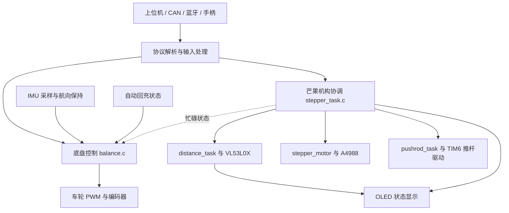

# C30D 项目架构梳理

分析日期：2026-11-07。范围：本地 `C30D-c30d-develop-import` 目录，对应用户提供的 `c30d-develop-import` 分支。以下结论依据实际源码和 Keil 工程引用关系；硬件表现需要实机验证。

## 1. 项目定位

这是在 WHEELTEC C30D 底盘工程上扩展的机器人下位机固件，核心是 **底盘运动控制 + 芒果击打机构控制**。上位机通过串口或 CAN 下发命令，STM32 负责采集传感器、运行控制算法并驱动执行机构。

| 项目 | 当前实现 |
| --- | --- |
| 主控 | STM32F407ZG，Cortex-M4F，168 MHz |
| 语言 | C；启动代码使用汇编；测试入口使用 Python |
| 操作系统 | FreeRTOS V9.0.0，抢占调度，1 ms 系统节拍 |
| 驱动基础 | STM32 标准外设库；USB Host 部分还使用 HAL HCD/LL USB 文件 |
| 构建入口 | [USER/WHEELTEC.uvprojx][keil]，目标名 `FreeRTOS`，ARMCC 5.06 |
| 主要输出 | `OBJ/WHEELTEC.hex`，供烧录到控制板 |
| 上位机关系 | 提供与 ROS 等上位机通信的协议；仓库主要内容为单片机固件 |

## 2. 目录与实际职责

下文用“固件目录”表示 `R550_C30D_2.0_Mini_STM32_GMR_Encoder_2025.12.26/`。

```text
C30D-c30d-develop-import/
├─ README.md                         外设接线、API 与串口联调说明
├─ docs/
│  └─ 项目架构梳理.md                 本文：整体结构与阅读导航
├─ tests/
│  ├─ chassis/                       底盘控制与航向保持回归测试
│  ├─ mango/                         击打状态机仿真及公共 ARM 测试运行器
│  └─ pushrod/                       推杆定时关断驱动测试
└─ R550_C30D_2.0_Mini_STM32_GMR_Encoder_2025.12.26/
   ├─ USER/                          main、芯片系统配置、Keil 工程
   ├─ BALANCE/                       系统初始化、底盘控制、机构任务、显示
   ├─ HARDWARE/                      板级驱动、传感器、通信、手柄与 USB Host
   ├─ AutoRecharge/                  自动回充状态变量与 CAN 配置发送
   ├─ SYSTEM/                        延时、底层系统工具与串口打印支持
   ├─ FreeRTOS/                      RTOS 内核、配置、移植层和内存管理
   ├─ FWLIB/                         STM32 外设库
   └─ CORE/                          Cortex-M4 支持头文件与启动汇编
```

`BALANCE/` 继承了厂家目录命名，目前承载了大部分应用逻辑，包括芒果机构任务。`HARDWARE/` 也包含 `data_task`、`pstwo_task` 等任务和协议处理，因此当前目录边界与业务边界并不完全一致。

判断某个文件是否参与固件构建，应检查 `.uvprojx` 的源文件清单。该工程列出 69 个 C 源文件、1 个启动汇编和 1 个更新记录文件。`BALANCE/control.c`、`BALANCE/filter.c`、两份 `DataScope_DP.C`、`HARDWARE/dma.c` 和 `HARDWARE/exti.c` 当前没有被该工程引用。它们可以作为历史或备用实现查阅，阅读主流程时优先看 [balance.c][balance]。

## 3. 总体分层与模块关系



可以按四层理解现有代码：

1. **业务流程层**：底盘运动、芒果击打、回充模式。
2. **任务与控制层**：FreeRTOS 任务、击打状态机、轮速 PI、航向保持。
3. **设备驱动层**：电机、步进、推杆、激光、IMU、串口、CAN、OLED。
4. **平台基础层**：芯片启动、外设库、FreeRTOS 内核和移植层。

目前这些层次主要体现在函数调用关系中，尚未全部落实为独立目录和严格的依赖边界。

## 4. 启动流程

```text
复位
  → CORE/startup_stm32f40_41xxx.s
  → SystemInit()：芯片时钟等基础配置
  → C 运行环境 → USER/main.c 的 main()
  → systemInit()：板级硬件与业务参数初始化
  → 创建 start_task → 启动 FreeRTOS 调度
  → start_task 创建业务任务 → 删除自身
```

注意区分两个大小写不同的函数：`SystemInit()` 位于 `USER/system_stm32f4xx.c`；[systemInit()][system] 位于 `BALANCE/system.c`。

板级初始化首先将 A4988 的 DIR/STEP、四路激光 XSHUT 和四路推杆输出配置为低电平，然后初始化延时、IMU 总线、串口等外设。根据 IMU 型号识别 V1_0/MPU6050 或 V1_1/ICM20948，选择相应硬件初始化；V1_1 还初始化 USB Host。无法识别 IMU 时执行系统复位。

随后初始化 OLED、按键、ADC、CAN、车型参数、编码器、步进定时器和车轮 PWM，探测回充硬件并读取 Flash 参数。车型由电位器 ADC 值决定，支持麦轮、全向轮、阿克曼、差速、四驱、履带及 V550 的相应变体。

正常模式创建 `Balance_task`；上电按键进入检查模式时，改为创建 `Check_task`。IMU 在启动阶段采集约 10 秒静止样本计算零偏，底盘控制使用这一启动计时。串口 1 的芒果文本命令识别位于这段底盘启动等待判断之前，不受该 10 秒门槛限制。

## 5. FreeRTOS 任务表

以下为 `main.c` 显式创建的任务。数值越大，任务优先级越高；栈大小按 FreeRTOS 栈元素计，当前 Cortex-M4 移植中每个元素为 4 字节。

| 任务入口 | 优先级 | 栈元素 | 调度节奏 | 主要职责 |
| --- | ---: | ---: | --- | --- |
| `start_task` | 0 | 256 | 启动时一次 | 创建下列任务后删除自身 |
| `Balance_task` / `Check_task` | 4 | 512 | 100 Hz | 正常底盘闭环 / 检查模式，二选一 |
| `MPU6050_task` / `ICM20948_task` | 3 | 256 | 100 Hz | IMU 采样与启动零偏校准，二选一 |
| `show_task` | 3 | 512 | 10 Hz | OLED、电压采样与 APP 状态显示 |
| `led_task` | 3 | 128 | 按 `Led_Count` 延时 | 板载 LED 状态 |
| `pstwo_task` | 4 | 256 | 100 Hz | 对应硬件版本的手柄数据读取 |
| `data_task` | 4 | 512 | 20 Hz | 打包并发送底盘反馈 |
| `pushrod_task` | 5 | 128 | 每轮延时 10 ms | 接收推杆请求，启动硬件定时，发布完成状态 |
| `stepper_Task` | 1 | 384 | 每轮延时 10 ms | 芒果机构总协调与异常处理 |
| `distance_task` | 1 | 256 | 测量前等待 50 ms，另加测量耗时 | 激光切换、初始化、采样和重试 |

测距配置的单次测量预算约为 100 ms，不能把 50 ms 等待直接理解为实际 20 Hz 出数频率。业务任务之外还有 RTOS 内部任务；V1_1 的 USB Host 通过其 OS 适配层管理后台处理。

内核配置位于 `FreeRTOS/include/FreeRTOSConfig.h`，使用 `heap_4.c`，配置的 RTOS 堆为 20 KB。任务优先级与 NVIC 中断优先级采用不同规则，不应直接比较。

## 6. 业务主线一：底盘运动控制

关键文件：[balance.c][balance]、[heading_control.c][heading]、[imu_task.c][imu]、[usartx.c][usartx]、`robot_select_init.c`。

```text
串口 / CAN / 蓝牙 / 手柄命令
  → 选择控制来源，形成 Move_X / Move_Y / Move_Z
  → Balance_task 每 10 ms 获取编码器实际轮速
  → 满足条件时加入 IMU 航向修正
  → Drive_Motor() 按车型做运动学逆解
  → 得到 MOTOR_A～D 的目标轮速
  → 四路增量式 PI → PWM 限幅 → Set_Pwm()
  → 编码器反馈，进入下一轮闭环
```

`Drive_Motor()` 根据车型将三轴速度分配到各轮；默认轮速 PI 参数由 `system.c` 提供，还可能被 Flash 配置覆盖。电压、硬件使能和软件停机标志共同影响车轮输出，自动回充模式使用单独的速度来源。

航向保持使用去除启动零偏后的 Z 轴陀螺值，积分得到相对航向，并输出角速度修正。它主要作用于默认串口 3 控制条件，显式转向、其他遥控来源、回充、阿克曼车型、启动校准期间等情况会退出并重置状态。

**底盘与上部机构的联动**：上部机构忙碌且底盘三轴目标速度都为零时，暂停并重置航向保持，避免停驻击打振动累积成纠偏。收到底盘移动命令后仍可行驶；机构忙碌状态没有被设计成底盘运动禁令。

## 7. 业务主线二：芒果击打机构

关键文件：[stepper_task.c][stepper]、[distance_task.c][distance]、[pushrod_task.c][pushrod-task]、[stepper_motor.c][stepper-driver]、[pushrod.c][pushrod-driver]。

### 编号与设备映射

| 串口 1 文本 | 激光 XSHUT | 步进机构 | 推杆输出 |
| --- | --- | --- | --- |
| `1` | PA2 | left | PC0 |
| `2` | PA3 | left | PC1 |
| `3` | PA6 | right | PC2 |
| `4` | PC10 | right | PC3 |

两路步进方向按当前宏定义：left 为 DIR 低靠近、高返程；right 为 DIR 高靠近、低返程。四路激光共享软件 I²C 和默认地址 0x29，通过 XSHUT 互斥使能，一次启用一路。

### 状态机

```text
WAITING_COMMAND / RETURNED
  → 收到编号并占用任务
  → WAITING_DISTANCE：选择激光，等待有效读数
  → MOVING：步进靠近，检查距离、计数和超时
  → STRIKING：到达 ≤150 mm，停车，推杆输出 5 秒
  → RETURNING：反向输出与前进相同数量的 STEP 脉冲
  → FINISHING：等待激光实际全关
  → RETURNED：发布结果，释放占用，允许下一次命令
```

初始距离已经不大于 150 mm 时直接进入击打，不发生前进和返程。一次只受理一个编号，忙碌时的新命令被拒绝，不排队。每次开始清除本轮脉冲计数，避免重复编号沿用旧行程。

协调任务采用 `StepperMotor_StartMove()` 非阻塞定量运动；脉冲由 TIM12/TIM8 的单脉冲模式和中断逐个输出、计数并执行加减速。停止后读取最终计数作为返程目标。计数表示已输出的指令脉冲，未通过机械原点开关或步进编码器确认物理位置。

推杆任务调用 `Pushrod_StartTimed()`。输出拉高后由 **TIM6 中断直接在 5 秒到时拉低输出**，任务随后确认完成并发布 `DONE`，协调任务才允许返程。

### 异常分支

- 首次测距最长等待 5 秒；超时后结束本轮，不击打。
- 测距快照达到 500 ms 未更新、读数无效或通道不匹配时，停止靠近并尝试返程。
- 前进上限为 70000 脉冲；前进、返程单段超时均为 420 秒。
- 推杆失败时关闭输出并尝试返程。
- 返程启动失败、异常停止或最终脉冲数不符时进入 `STEPPER_FAULT`，保留忙碌锁定，需检查原点后复位。
- `done` 只表示本轮结束；成功还要求 `result=0`。

## 8. 通信、共享数据与中断

| 接口 | 当前用途 |
| --- | --- |
| USART1，115200 | 文本 `1`～`4` 触发击打并输出阶段日志；保留原二进制底盘命令解析，默认关闭二进制反馈 |
| USART2，9600 | 蓝牙 APP；标准 `printf` 当前也重定向到 USART2 |
| USART3，115200 | 默认上位机/ROS 底盘控制与反馈 |
| UART5，115200 | 备用上位机控制与反馈 |
| CAN | 底盘控制、反馈及回充硬件通信 |
| PS2 / USB Host | 按硬件版本接入手柄 |

普通底盘控制帧为 11 字节，`0x7B` 开头、`0x7D` 结尾，带三轴速度和异或校验；常规底盘反馈帧为 24 字节。回充还有独立状态帧。详细字段见根目录 [README](../README.md#串口协议)。

机构任务通过“提交请求 + 读取快照”协作：协调任务请求激光和推杆动作，再读取 `DistanceTask_Data`、`PushrodTask_Data` 和电机状态推进状态机。测距任务独占 VL53L0X 总线，显示任务读取快照并统一刷新 OLED。相关快照使用临界区保护，USART1 请求使用短暂全局关中断保护；该流程未使用 RTOS 队列。

旧底盘部分主要通过 `system.c/system.h` 中的全局变量共享目标速度、轮速、车型和控制来源，模块之间耦合较多。

中断入口分散在不同文件中：

| 中断 | 实现位置 | 用途 |
| --- | --- | --- |
| `USART1_IRQHandler` 等串口中断 | `HARDWARE/usartx.c` | 接收解析；USART1 锁存机构请求 |
| `CAN1_RX0_IRQHandler` | `HARDWARE/can.c` | CAN 控制与回充状态 |
| `TIM8_BRK_TIM12_IRQHandler` | `HARDWARE/encoder.c` | 分发左步进 TIM12 更新 |
| `TIM8_UP_TIM13_IRQHandler` | `HARDWARE/timer.c` | 分发右步进 TIM8 更新 |
| `TIM6_DAC_IRQHandler` | `HARDWARE/pushrod.c` | 推杆定时关断 |

串口 1、步进和推杆关断中断的抢占优先级分别为 3、4、0，高于当前 FreeRTOS 系统调用阈值 5；这些路径不应加入 FreeRTOS API 调用。

## 9. 参数与硬件资源导航

| 需要调整的内容 | 入口 |
| --- | --- |
| 击打距离、左右方向、速度 ARR、脉冲上限、运动超时 | `BALANCE/stepper_task.h` |
| 推杆击打时长 | `BALANCE/pushrod_task.h` 的 `MANGO_STRIKE_MS` |
| 测距轮询、数据过期与重试 | `BALANCE/distance_task.c` |
| 测距预算、驱动超时、SCL/SDA | `HARDWARE/vl53l0x.h`、`vl53l0x.c` |
| 航向 PID、死区、容差与开关 | `BALANCE/heading_control.h` |
| 车型尺寸、轮径、减速比、编码器参数 | `BALANCE/robot_select_init.h`、`.c` |
| 轮速 PI 默认值、全局状态 | `BALANCE/system.c`；运行参数还可能来自 Flash |
| 任务创建与启动组合 | `USER/main.c` |
| 系统节拍、RTOS 堆、中断阈值 | `FreeRTOS/include/FreeRTOSConfig.h` |

当前关键资源：left 使用 PB14/PB15 与 TIM12_CH2；right 使用 PC7/PC8 与 TIM8_CH3；推杆使用 PC0～PC3 与 TIM6；激光使用 PA8/PC9 及 PA2/PA3/PA6/PC10；IMU 使用 PB10/PB11。两路 A4988 的 EN 由外部接线控制，`StepperMotor_Disable()` 停止 STEP 输出而不改变 EN。

PA8 已用于激光 SCL，蜂鸣器宏 `BUZZER_ENABLED=0`。TIM8/TIM12 已用于步进；后续恢复原工程的舵机或遥控输入功能前，需要重新分配这些资源。

## 10. 构建、测试与阅读顺序

打开 [USER/WHEELTEC.uvprojx][keil]，使用其 `FreeRTOS` 目标和 ARMCC 5 工具链构建。当前工程使用 RVDS/ARM_CM4F 移植层；其他 Cortex 移植目录只是随 FreeRTOS 一并保留。原 README 中的 EIDE 输出绝对路径属于作者本机环境记录，通用入口以仓库内 Keil 工程为准。

现有测试使用 ARMCC 编译测试目标，再由 Unicorn 执行 ARM 指令，依赖 `unicorn` 与 `pyelftools`。测试运行器默认工具链路径为 `D:/Keil_v5/ARM/ARMCC/bin`，可通过 `ARMCC_BIN` 指定其他位置。

| 测试 | 覆盖重点 | 在仓库根目录执行 |
| --- | --- | --- |
| [mango](../tests/mango/README.md) | 14 组场景：编号映射、忙碌拒绝、状态转换、返程及故障、激光切换 | `uv run --with unicorn --with pyelftools python tests/mango/run_tests.py` |
| [chassis](../tests/chassis/README.md) | 6 组场景：航向保持、停驻击打振动抑制、恢复移动、显式转向等 | `uv run --with unicorn --with pyelftools python tests/chassis/run_tests.py` |
| [pushrod](../tests/pushrod/README.md) | 实际驱动的寄存器逻辑、硬件定时关断、取消与重启 | `uv run --with unicorn --with pyelftools python tests/mango/run_tests.py tests/pushrod/test_pushrod.c` |

`mango` 直接编译生产任务，但模拟调度、步进和传感器；`chassis` 提取生产控制函数进行仿真；`pushrod` 使用模拟寄存器测试真实驱动。它们不能证明实物时序、失步和机械回原位表现。

建议按以下顺序阅读：

1. [main.c][main]：看任务如何启动。
2. [system.c][system] 和 `system.h`：看外设、车型、全局状态。
3. [stepper_task.c][stepper]：看当前机构业务全流程。
4. [distance_task.c][distance]、[pushrod_task.c][pushrod-task]：看子任务如何协作。
5. [stepper_motor.c][stepper-driver]、[pushrod.c][pushrod-driver]：看定时器和执行机构。
6. [balance.c][balance]、[heading_control.c][heading]、[imu_task.c][imu]：看底盘闭环。
7. [usartx.c][usartx]、`can.c` 和三个测试目录：看对外协议与已有验证。

本次已检查 Keil 工程中的文件引用和主要调用关系。当前分析环境未找到测试默认位置的 ARMCC，也未安装上述 Python 仿真依赖，因此本次没有执行固件构建或仿真测试，未连接控制板。

## 11. 后续整理建议

以下是后续重构方向，当前保留既有目录和运行逻辑。

| 顺序 | 建议 | 原因 |
| --- | --- | --- |
| 1 | 将引脚、定时器和设备映射集中到板级配置 | 原 README 的激光 4 引脚与右侧方向曾落后于代码；本次已按实现修正文档 |
| 2 | 将应用职责明确为 `chassis`、`mango`、`communication`、`ui` | `BALANCE/` 与 `HARDWARE/` 中混合了业务、任务、协议和驱动 |
| 3 | 从大文件中逐步提取协议解析、运动学和参数存储 | `balance.c` 约 1255 行、`usartx.c` 约 1502 行，修改边界较大 |
| 4 | 为共享数据建立明确接口，减少总头文件依赖 | `system.h` 汇集大量头文件和全局变量，变更容易扩散 |
| 5 | 分开维护当前参与构建的实现和历史备用代码 | `control.c` 等文件仍在目录中，但不参与当前 Keil 构建 |
| 6 | 统一记录构建环境，逐步接入自动测试 | 工具链路径与 ARM 编译器依赖仍具有本机特征 |
| 7 | 审核日志、IDE 布局、`.orig` 和根目录异常命名文件 | 它们影响项目导航；确认用途后再归档或清理 |

若后续调整目录，可考虑 `app/` 放业务任务，`control/` 放算法，`drivers/` 放器件驱动，`bsp/` 放引脚和板级配置，`middleware/` 放 FreeRTOS/USB，`vendor/` 放芯片库，并保留 `tests/` 和 `docs/`。迁移时需要同步更新 Keil 文件路径和 include 路径，宜逐模块进行。

[keil]: ../R550_C30D_2.0_Mini_STM32_GMR_Encoder_2025.12.26/USER/WHEELTEC.uvprojx
[main]: ../R550_C30D_2.0_Mini_STM32_GMR_Encoder_2025.12.26/USER/main.c
[system]: ../R550_C30D_2.0_Mini_STM32_GMR_Encoder_2025.12.26/BALANCE/system.c
[balance]: ../R550_C30D_2.0_Mini_STM32_GMR_Encoder_2025.12.26/BALANCE/balance.c
[heading]: ../R550_C30D_2.0_Mini_STM32_GMR_Encoder_2025.12.26/BALANCE/heading_control.c
[imu]: ../R550_C30D_2.0_Mini_STM32_GMR_Encoder_2025.12.26/BALANCE/imu_task.c
[usartx]: ../R550_C30D_2.0_Mini_STM32_GMR_Encoder_2025.12.26/HARDWARE/usartx.c
[stepper]: ../R550_C30D_2.0_Mini_STM32_GMR_Encoder_2025.12.26/BALANCE/stepper_task.c
[distance]: ../R550_C30D_2.0_Mini_STM32_GMR_Encoder_2025.12.26/BALANCE/distance_task.c
[pushrod-task]: ../R550_C30D_2.0_Mini_STM32_GMR_Encoder_2025.12.26/BALANCE/pushrod_task.c
[stepper-driver]: ../R550_C30D_2.0_Mini_STM32_GMR_Encoder_2025.12.26/HARDWARE/stepper_motor.c
[pushrod-driver]: ../R550_C30D_2.0_Mini_STM32_GMR_Encoder_2025.12.26/HARDWARE/pushrod.c
